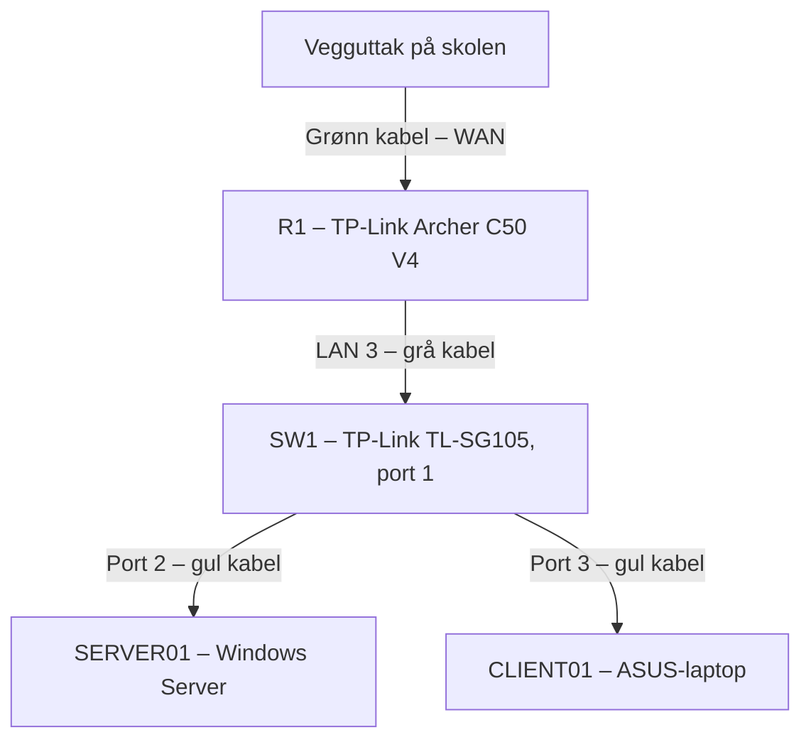

# Nettverksprosjekt – Vg2 IT

## 1. Om prosjektet

I dette prosjektet har jeg jobbet med å sette opp, konfigurere og teste nettverk. Prosjektet består av to deler: et fysisk nettverk på skolen og et større nettverk i Cisco Packet Tracer.

I den første delen brukte jeg en TP-Link-ruter, en switch, en Windows Server-PC (SERVER01) og ASUS-laptopen min (CLIENT01). Jeg koblet sammen utstyret, satte opp IP-adresser og testet om enhetene kunne kommunisere med hverandre.

I den andre delen laget jeg et nettverk for en fiktiv bedrift som heter FjordTek AS. Jeg delte nettverket inn i forskjellige avdelinger: Administrasjon, Support, Servere og Salg. Her jobbet jeg blant annet med VLAN, ruting, DHCP, DNS og HTTP.

### 1.1 Målet mitt

Målet mitt var å forstå bedre hvordan et nettverk fungerer, både i praksis og i en simulering.

Jeg ville lære hvordan jeg kan koble sammen forskjellige enheter, konfigurere riktige IP-adresser og sørge for at klientene får kontakt med serveren.

Jeg ønsket også å bli bedre på feilsøking. Når noe ikke fungerte, prøvde jeg å finne ut hva som var feil, teste en mulig løsning og kontrollere resultatet etterpå.

### 1.2 Dokumentasjon

Jeg bruker GitHub til å samle arbeidet mitt. Her skal jeg vise hvordan jeg planla nettverket, hvilke innstillinger jeg brukte, hvilke tester jeg gjennomførte, og hvilke problemer jeg møtte underveis.

Jeg legger også ved skjermbilder fra testene og forklarer hva resultatene betyr.

Hvis jeg mangler et skjermbilde eller ikke har fått testet noe ferdig, skal jeg skrive det tydelig i dokumentasjonen.


## 2. Kravspesifikasjon

Før jeg startet med nettverket, måtte jeg lage en kravspesifikasjon. Den skulle vise hva nettverket måtte kunne gjøre når prosjektet var ferdig.

Jeg tok utgangspunkt i kravene fra læreren og valgte ett ekstra krav selv.

| Krav | Hva nettverket skal kunne gjøre | Hvordan jeg skal teste det |
|---|---|---|
| K1 | SERVER01 og CLIENT01 skal kunne kommunisere i det fysiske nettverket. | Jeg bruker `ping` fra CLIENT01 til SERVER01 og kontrollerer om jeg får svar. |
| K2 | SERVER01 skal ha fast IP-adresse. | Jeg kontrollerer IP-innstillingene med `ipconfig /all`. |
| K3 | CLIENT01 skal få IP-adresse automatisk fra ruteren med DHCP. | Jeg bruker `ipconfig /all` for å sjekke IP-adresse, gateway og DHCP-server. |
| K4 | CLIENT01 skal kunne bruke minst én tjeneste på SERVER01. | Jeg åpner den delte mappen `Felles` fra CLIENT01 og tester om jeg kan opprette en fil. |
| K5 | Nettverket i Cisco Packet Tracer skal ha flere LAN med ruting mellom dem. | Jeg tester med `ping`, `tracert` og `show ip route`. |
| K6 | Klientene i Packet Tracer skal få riktige nettverksinnstillinger og kunne bruke DNS og HTTP. | Jeg kontrollerer DHCP og tester om intranettsiden kan åpnes med IP-adresse og DNS-navn. |
| K7 | Nettverkene skal testes, og resultatene skal dokumenteres. | Jeg samler testresultater, skjermbilder og forklaringer i GitHub. |
| K8 | CLIENT01 skal kunne fornye IP-adressen med DHCP og fortsatt ha kontakt med SERVER01. | Jeg bruker `ipconfig /release`, `ipconfig /renew` og tester deretter forbindelsen med `ping`. |

### 2.1 Hvorfor jeg valgte K8

Jeg valgte DHCP-fornyelse som mitt eget krav fordi jeg ville undersøke hva som skjer når en klient ber om en ny IP-adresse.

Det er viktig at en PC får riktige nettverksinnstillinger automatisk og fortsatt kan kommunisere med andre enheter etter at adressen er fornyet.

### 2.2 Hvordan jeg skal kontrollere kravene

Når jeg har dokumentert oppsettet og testene, skal jeg sammenligne resultatene med kravspesifikasjonen.

I akseptansetesten (QA) skal jeg skrive hva jeg forventet, hva som faktisk skjedde, og om testen ble bestått.

Hvis jeg mangler dokumentasjon på et krav, skal jeg skrive det tydelig i stedet for å markere det som fullt dokumentert.


## 3. Fysisk nettverk – topologi og utstyr

### 3.1 Utstyret jeg brukte

Jeg startet prosjektet med å bygge et fysisk nettverk på skolen. Jeg brukte en ruter, en switch, en Windows Server-PC og min egen ASUS-laptop.

| Navn | Utstyr | Funksjon |
|---|---|---|
| R1 | TP-Link Archer C50 V4 | Ruter og DHCP-server |
| SW1 | TP-Link TL-SG105 | Switch med fem porter |
| SERVER01 | Stasjonær PC med Windows Server | Server for blant annet fildeling |
| CLIENT01 | ASUS-laptop med USB-Ethernet-adapter | Klient for konfigurering og testing |

SERVER01 fikk senere installert Windows Server 2025 Standard på nytt.

### 3.2 Hvordan jeg koblet utstyret

Den 20.10.2026 dokumenterte jeg hvordan utstyret var koblet sammen.

Jeg koblet både SERVER01 og CLIENT01 til SW1 med Ethernet-kabler. Deretter koblet jeg ruteren til switchen.

Dette var portene og kablene jeg brukte:

| Fra | Port | Til | Port | Kabel |
|---|---|---|---|---|
| Vegguttak | Ethernet | R1 | Internet/WAN | Grønn |
| R1 | LAN 3 | SW1 | Port 1 | Grå/sølv |
| SW1 | Port 2 | SERVER01 | Ethernet | Gul |
| SW1 | Port 3 | CLIENT01 | USB-Ethernet | Gul |

Læreren hadde godkjent at jeg brukte den grønne kabelen fra skolens nettverksuttak til WAN-porten på R1.

Jeg brukte ikke WAN-porten for å koble til switchen. Den lokale forbindelsen mellom R1 og SW1 gikk gjennom LAN 3.

### 3.3 Nettverkstopologi

Nettverket var koblet slik:



Diagrammet viser den fysiske oppkoblingen. Både klienten og serveren var koblet til samme switch.

### 3.4 Kontroll av fysisk tilkobling

Etter at kablene var koblet til, kontrollerte jeg utstyret og statuslysene.

Jeg observerte grønne lys ved de tilkoblede switchportene. Dette tydet på at det var fysisk link mellom enhetene.

Jeg tok bilder av ruteren, switchen, kablene og arbeidsplassen for å dokumentere oppkoblingen.

Jeg lærte at linklys ikke alene betyr at nettverket fungerer riktig. Lysene viser fysisk forbindelse, men IP-adresser og kommunikasjon må testes separat.

Derfor gjennomførte jeg senere ping-tester mot R1 og SERVER01.

### 3.5 Hvorfor jeg valgte denne oppkoblingen

Jeg koblet både klienten og serveren til switchen fordi de skulle kommunisere i samme lokale nettverk.

R1 hadde LAN-adressen `192.168.50.1` og skulle fungere som standard gateway og DHCP-server for CLIENT01.

SERVER01 skulle ha fast IP-adresse, slik at klienten kunne nå serveren på en kjent adresse.

Jeg brukte USB-Ethernet-adapteren på CLIENT01 for å koble laptopen til det kablede labnettet.

Ved å skrive ned hvilke porter og kabler jeg hadde brukt, ble det enklere å kontrollere oppkoblingen og finne feil senere.

### 3.6 Dokumentasjon

Jeg har tatt bilder av den fysiske oppkoblingen, blant annet:

- Nettverkstopologien
- Ruterens kabeltilkoblinger
- Switchportene og linklysene
- Ruteren og statuslysene
- Arbeidsplassen med SERVER01 og CLIENT01
- Oversikt over nettverksutstyret

Bildene viser hvordan utstyret var koblet opp. Selve IP-kommunikasjonen dokumenterer jeg gjennom de separate nettverkstestene.

## 4. IP-adresseplan og konfigurering

### 4.1 Adresseplan

Jeg brukte nettverket `192.168.50.0/24` i den fysiske laben. Subnettmasken var `255.255.255.0`.

| Enhet | IP-adresse | Gateway | Tildeling |
|---|---|---|---|
| R1 | 192.168.50.1 | – | Fast LAN-adresse |
| SERVER01 | 192.168.50.10 | 192.168.50.1 | Statisk |
| CLIENT01 – manuell test | 192.168.50.20 | 192.168.50.1 | Statisk |
| CLIENT01 – DHCP-test | 192.168.50.100 | 192.168.50.1 | DHCP |

Jeg ville ha en fast adresse på serveren, slik at klienten alltid kunne bruke samme IP-adresse for å få tilgang til den.

På CLIENT01 testet jeg først manuell IP-konfigurasjon og senere DHCP.

### 4.2 Konfigurering av R1 – 20.10.2026

Jeg brukte en TP-Link Archer C50 V4 som ruter.

Da jeg først åpnet administrasjonssiden, hadde ruteren LAN-adressen `192.168.0.1`.

Jeg endret adressen til `192.168.50.1`, slik at den passet med adresseplanen min.

Etter endringen mistet CLIENT01 midlertidig tilgang til administrasjonssiden fordi nettverksinnstillingene på klienten ikke lenger passet med den nye adressen.

Jeg brukte derfor:

```cmd
ipconfig /release
ipconfig /renew
```

Etterpå fikk klienten IP-adressen `192.168.50.100`, og jeg kunne åpne administrasjonssiden på `http://192.168.50.1`.

Jeg testet også forbindelsen med `ping 192.168.50.1` og fikk svar.

### 4.3 Kontroll av DHCP på ruteren

Jeg åpnet **DHCP → DHCP Settings** på ruteren og kontrollerte innstillingene.

| Innstilling | Verdi |
|---|---|
| DHCP Server | Enabled |
| Start IP Address | 192.168.50.100 |
| End IP Address | 192.168.50.199 |
| Lease Time | 120 minutter |
| Default Gateway | 192.168.50.1 |
| DNS Server | 0.0.0.0 |
| Secondary DNS Server | 0.0.0.0 |

DHCP var allerede aktivert med riktig adresseområde da jeg kontrollerte denne siden. Jeg trengte derfor ikke å endre innstillingene.

DNS-feltene hadde ingen eksplisitt DNS-adresse i ruterens oppsett.

Jeg brukte DHCP-området fra `.100` til `.199` for å holde adressene til ruteren og serveren utenfor området som ble delt ut automatisk.

### 4.4 Statisk IP på SERVER01

Jeg jobbet med å sette SERVER01 til:

- IP-adresse: `192.168.50.10`
- Subnettmaske: `255.255.255.0`
- Default gateway: `192.168.50.1`

Jeg brukte `ncpa.cpl` for å åpne nettverkstilkoblingene og endre IPv4-innstillingene.

Serveren ble senere installert på nytt med Windows Server 2025. Etter reinstallasjonen fikk jeg igjen svar fra `192.168.50.10`, men jeg mangler en fullstendig `ipconfig /all` fra SERVER01 som bekrefter alle innstillingene i den siste installasjonen.

Derfor er serverens endelige IP-konfigurasjon ikke fullt dokumentert med et eget skjermbilde.

### 4.5 Første test med statisk IP på CLIENT01 – 21.10.2026

Jeg testet CLIENT01 med disse innstillingene:

| Innstilling | Verdi |
|---|---|
| IPv4-adresse | 192.168.50.20 |
| Subnettmaske | 255.255.255.0 |
| Default gateway | 192.168.50.1 |

Jeg kontrollerte adressene med `ipconfig`.

Deretter kjørte jeg:

```cmd
ping 192.168.50.1
ping 192.168.50.10
```

Jeg fikk fire svar fra både ruteren og serveren, uten pakketap.

Dette viste at klienten kunne kommunisere med begge enhetene med den manuelle IP-konfigurasjonen.

### 4.6 DHCP-test på CLIENT01 – 21.10.2026

Etter testen med statisk IP satte jeg Ethernet 2 på CLIENT01 tilbake til automatisk IP-adressering.

Jeg brukte USB-Ethernet-adapteren **ASIX AX88179 USB 3.0 to Gigabit Ethernet Adapter**.

Deretter kontrollerte jeg innstillingene med:

```cmd
ipconfig /all
```

Dette var resultatet:

| Innstilling | Resultat |
|---|---|
| DHCP Enabled | Yes |
| IPv4 Address | 192.168.50.100 |
| Subnet Mask | 255.255.255.0 |
| Default Gateway | 192.168.50.1 |
| DHCP Server | 192.168.50.1 |
| DNS Servers | 192.168.50.1 |
| Lease Obtained | 21.10.2026 kl. 09:57:21 |
| Lease Expires | 21.10.2026 kl. 11:57:20 |

Her kunne jeg bekrefte at CLIENT01 fikk adressen fra R1.

Leietiden var omtrent 120 minutter, som stemte med DHCP-innstillingene på ruteren.

### 4.7 Kontroll av forbindelsen etter DHCP

Etter DHCP-testen kjørte jeg Ping på nytt:

```cmd
ping 192.168.50.1
ping 192.168.50.10
```

Resultatene var:

| Mål | Sendt | Mottatt | Pakketap |
|---|---|---|---|
| R1 – 192.168.50.1 | 4 | 4 | 0 % |
| SERVER01 – 192.168.50.10 | 4 | 4 | 0 % |

Jeg fikk svar fra begge enhetene etter overgangen til DHCP.

Dette viste at klienten hadde fått riktige nettverksinnstillinger og fortsatt kunne kommunisere med ruteren og serveren.

### 4.8 Hva jeg lærte

Jeg lærte forskjellen mellom statisk IP og DHCP.

Med statisk IP måtte jeg skrive inn adressen selv. Med DHCP fikk klienten automatisk IP-adresse, gateway og DNS-innstillinger.

Jeg lærte også at når jeg endrer LAN-adressen på en ruter, må klientens nettverksinnstillinger passe med det nye subnettet.

Testene mine viste at DHCP fungerte, men jeg har ikke ett sammenhengende skjermbilde som viser hele prosessen fra `ipconfig /release` og `ipconfig /renew` til den siste Ping-testen.

Jeg har derfor dokumentert de registrerte testene og resultatene hver for seg.

## 5. Testing av fysisk nettverk

Etter at jeg hadde koblet sammen utstyret og konfigurert IP-adressene, begynte jeg å teste nettverket.

Jeg ville først finne ut om CLIENT01 hadde fått riktige nettverksinnstillinger. Deretter testet jeg om klienten kunne kommunisere med ruteren og SERVER01.

### 5.1 Kontroll av IP-adresse

På CLIENT01 brukte jeg kommandoen:

`ipconfig /all`

Jeg brukte denne kommandoen for å kontrollere IP-adressen, subnettmasken og standard gateway.

CLIENT01 fikk IP-adressen `192.168.50.100`, som ligger innenfor DHCP-området jeg hadde konfigurert på ruteren.

Dette viste at klienten hadde fått en adresse fra riktig nettverk.

### 5.2 Ping til ruteren

Jeg åpnet kommandolinjen (CMD) på CLIENT01 og kjørte:

`ping 192.168.50.1`

Jeg ville kontrollere at klienten hadde kontakt med ruteren på det lokale nettverket.

**Resultat fra testen:**
- Pakker sendt: 4
- Pakker mottatt: 4
- Pakketap: 0 %

Ruteren svarte på alle fire forespørslene. Dette viste at CLIENT01 kunne nå ruteren med ICMP.

### 5.3 Ping til SERVER01

Etterpå testet jeg forbindelsen mellom klienten og serveren:

`ping 192.168.50.10`

SERVER01 hadde IP-adressen `192.168.50.10`.

**Resultat fra testen:**
- Pakker sendt: 4
- Pakker mottatt: 4
- Pakketap: 0 %

Jeg fikk svar fra SERVER01 på alle fire forespørslene.

Dette viste at klienten og serveren kunne kommunisere med ICMP da testen ble gjennomført. Det betydde ikke nødvendigvis at alle tjenestene på serveren fungerte. Derfor måtte jeg teste fildeling separat.

### 5.4 Hva jeg fant ut

Resultatene viste at den grunnleggende nettverksforbindelsen fungerte på tidspunktet jeg testet.

Jeg hadde fått riktig IP-adresse på klienten, og jeg kunne nå både ruteren og serveren.

Jeg lærte også at en vellykket ping ikke betyr at alle nettverkstjenester fungerer. En server kan svare på ping selv om for eksempel fildeling er blokkert av brannmuren.

Dette ble viktig senere da jeg jobbet med SMB og Windows-brannmuren.

### 5.5 Begrensning i dokumentasjonen

Jeg har testresultater fra arbeidet med det fysiske nettverket. Windows Server ble senere installert på nytt, og jeg har ikke en fullstendig sluttkontroll av serverens nettverksinnstillinger etter reinstallasjonen.

Derfor skiller jeg mellom testene jeg faktisk gjennomførte, og det jeg ikke fikk kontrollert på nytt.


## 6. SERVER01 og SMB-fildeling

### 6.1 Oppsett av fildeling

Jeg brukte SERVER01 som en filserver i det fysiske nettverket.

Målet var at CLIENT01 skulle kunne åpne en delt mappe på serveren og bruke den over nettverket.

Jeg opprettet en mappe med navnet `Felles` og jobbet med delingsinnstillinger og en lokal testbruker på Windows Server.

Fra CLIENT01 brukte jeg denne adressen i Filutforsker:

`\\192.168.50.10\Felles`

Adressen viser IP-adressen til serveren og navnet på den delte mappen.

### 6.2 Kontroll av SMB-forbindelsen – 22.10.2026

Jeg brukte PowerShell på CLIENT01 for å kontrollere forbindelsen:

```powershell
Get-SmbConnection
```

Resultatet jeg dokumenterte i arbeidsloggen, viste:

- ServerName: `192.168.50.10`
- ShareName: `Felles`
- En aktiv SMB-forbindelse

Jeg kunne også se at forbindelsen brukte påloggingsinformasjon knyttet til SERVER01.

Dette viste at klienten hadde en SMB-forbindelse til den delte mappen.

### 6.3 Test av fildeling

Jeg skrev i arbeidsloggen at jeg hadde opprettet og kontrollert en testfil på serveren.

Jeg mangler likevel et eget skjermbilde som viser filen på SERVER01. Jeg har heller ikke et fullstendig bilde av de endelige Share- og NTFS-tillatelsene etter reinstallasjonen.

Derfor kan jeg dokumentere SMB-forbindelsen, men ikke hele filtesten med direkte skjermbildebevis.

### 6.4 SMB og Windows Firewall

SMB brukes til fildeling i Windows og benytter vanligvis TCP-port 445.

Jeg undersøkte senere porten med Nmap og så at `445/tcp` var åpen.

Etter reinstallasjonen hadde jeg også et problem med ping mot SERVER01. Jeg undersøkte Windows Firewall og aktiverte en regel for ICMPv4 Echo Requests.

Dette var en egen ICMP-feil, som jeg har beskrevet i kapittel 11. Jeg har ikke grunnlag for å si at den samme regelen løste SMB-problemer.

### 6.5 Hva jeg lærte

Jeg lærte hvordan en klient kan bruke en delt mappe på en Windows-server.

Jeg forstod også at det er forskjell på å ha nettverkskontakt med serveren, å ha en aktiv SMB-forbindelse og å ha tillatelse til å lese eller skrive filer.

En åpen TCP-port eller en aktiv forbindelse er ikke alene bevis på at alle filoperasjoner fungerer.


## 7. Nmap og nettverksporter

### 7.1 Hvorfor jeg brukte Nmap

Etter at jeg hadde jobbet med fildeling, ville jeg undersøke hvilke TCP-porter jeg kunne nå på SERVER01.

Jeg brukte Nmap fra CLIENT01 og begrenset skanningen til labserveren `192.168.50.10`.

Før skanningen kontrollerte jeg at Nmap var installert ved å bruke:

```powershell
nmap --version
```

Jeg hadde Nmap 7.99 og Npcap 1.88 installert på klienten.

### 7.2 Portskanning – 22.10.2026

Jeg kjørte denne kommandoen i PowerShell:

```powershell
nmap -sT -Pn -p 135,139,445 192.168.50.10
```

Jeg brukte:

- `-sT` for TCP Connect-skanning.
- `-Pn` for å hoppe over vanlig vertoppdagelse.
- `-p` for å velge bare portene 135, 139 og 445.

Skanningen ble gjennomført klokken 10:57 og tok 3,59 sekunder.

### 7.3 Resultatet jeg fikk

| Port | State | Service |
|---|---|---|
| 135/tcp | open | msrpc |
| 139/tcp | filtered | netbios-ssn |
| 445/tcp | open | microsoft-ds |

Port 135 var åpen. Denne porten brukes vanligvis av Microsoft RPC.

Port 139 ble vist som `filtered`. Det betyr at Nmap ikke fikk nok informasjon til å avgjøre om porten var åpen eller lukket. Filtrering i nettverket eller en brannmur kan være en forklaring.

Port 445 var åpen. Dette var spesielt relevant fordi jeg hadde brukt SMB til å koble CLIENT01 til mappen `Felles`.

### 7.4 Hvordan jeg tolket resultatet

Nmap viste også `Host is up`, men jeg brukte `-Pn`, som hopper over vanlig vertoppdagelse. Derfor brukte jeg ikke denne meldingen som bevis på en egen vellykket ping-test.

Tjenestenavnene i Nmap-resultatet var standard navn knyttet til portnumrene. Jeg brukte ikke `-sV` for å undersøke hvilken programvareversjon som kjørte på portene.

Jeg lærte at Nmap kan vise om en TCP-port er tilgjengelig, men at det ikke automatisk betyr at jeg har tilgang til tjenesten.

For eksempel viste Nmap at port 445 var åpen, men dette beviste ikke hvilke Share- eller NTFS-tillatelser brukeren hadde.

### 7.5 Hva jeg lærte

Jeg fikk bedre forståelse av sammenhengen mellom IP-adresser, porter og nettverkstjenester.

Jeg lærte også forskjellen mellom `open` og `filtered`, og hvorfor det er viktig å tolke resultatene riktig.

Jeg gjorde ingen endringer i brannmurinnstillingene som følge av denne skanningen.


## 8. Wireshark – analyse av nettverkstrafikk

### 8.1 Hvorfor jeg brukte Wireshark

Den 22.10.2026 brukte jeg Wireshark på CLIENT01 for å undersøke trafikken mellom klienten og SERVER01.

Jeg hadde allerede testet forbindelsen med ping og undersøkt porter med Nmap. Nå ville jeg se hvilke pakker som faktisk ble sendt mellom maskinene.

Jeg brukte nettverksadapteren `Ethernet 2` til pakkefangsten.

### 8.2 ICMP – trafikk fra ping

Jeg undersøkte ICMP-trafikk med dette visningsfilteret:

`icmp`

I Wireshark fant jeg åtte ICMP-pakker mellom:

- CLIENT01: `192.168.50.100`
- SERVER01: `192.168.50.10`

Det var fire Echo Request og fire Echo Reply, med sekvensnumrene 37, 38, 39 og 40.

Pakkene hadde en lengde på 74 byte i Wireshark.

Jeg sammenlignet Source og Destination for å se hvordan trafikken gikk mellom klienten og serveren.

**Resultat:**

Jeg kunne se både forespørsler og svar. Det viste at ICMP-kommunikasjonen fungerte i denne pakkefangsten.

Bildet viste fire forespørsel-/svarpar, men ikke den fullstendige statistikken fra ping-kommandoen. Derfor bruker jeg ikke dette bildet alene til å dokumentere pakketapsprosenten.

### 8.3 SMB – trafikk på TCP-port 445

Etterpå undersøkte jeg trafikken i forbindelse med den delte mappen `Felles`.

Jeg brukte dette filteret:

`ip.addr == 192.168.50.10 && tcp.port == 445`

Filteret viste TCP-trafikk der SERVER01 var avsender eller mottaker, og der kilde- eller målporten var 445.

I pakkefangsten kunne jeg se kommunikasjon mellom CLIENT01 og SERVER01.

En av pakkene viste:

- Source IP: `192.168.50.100`
- Destination IP: `192.168.50.10`
- TCP Source Port: `34647`
- TCP Destination Port: `445`

Jeg kunne også se TCP-trafikk i motsatt retning, fra port 445 på serveren til port 34647 på klienten.

Wireshark viste flere pakker med protokolletiketten `SMB2`.

### 8.4 SMB-meldingene jeg fant

Jeg kunne blant annet se disse meldingene:

| Melding | Hva den viser |
|---|---|
| Create Request | Klienten sender en forespørsel om å åpne et objekt |
| Create Response | Serveren svarer på forespørselen |
| Close Request | Klienten ber om å lukke et objekt |
| Close Response | Serveren svarer på lukkingen |
| Cancel Request | En forespørsel blir forsøkt avbrutt |
| Notify Response – STATUS_CANCELLED | En forespørsel om varsling er blitt avbrutt |

Jeg la merke til at noen av pakkene viste `Create Request, File: <share>`.

Dette var interessant fordi det viste SMB-kommandoer knyttet til delingen. Men det var ikke et bevis på at jeg hadde opprettet en vanlig testfil i mappen.

Jeg så også `STATUS_CANCELLED`. Jeg kunne ikke konkludere med at fildelingen hadde feilet bare på grunn av denne meldingen.

### 8.5 Forskjellen mellom Nmap og Wireshark

Jeg brukte Nmap for å undersøke hvilke TCP-porter som var tilgjengelige på SERVER01.

Nmap viste blant annet at port 445 var åpen.

Med Wireshark kunne jeg se selve kommunikasjonen som brukte port 445, inkludert TCP-pakker og SMB-meldinger.

Jeg lærte at Nmap og Wireshark brukes til forskjellige oppgaver. Nmap undersøker blant annet porttilgjengelighet, mens Wireshark gjør det mulig å analysere nettverkspakker.

### 8.6 Hva jeg lærte

Denne oppgaven gjorde det lettere for meg å forstå hvordan klienten og serveren kommuniserer.

Jeg lærte å bruke visningsfiltre for å finne relevante pakker og å undersøke IP-adresser, porter og protokoller.

Jeg lærte også at jeg må være forsiktig når jeg tolker resultater. SMB-trafikk viser at det foregår kommunikasjon, men beviser ikke alene at en bestemt fil ble lagret, eller hvilke rettigheter brukeren har.

Jeg har dokumentert ICMP- og SMB-trafikken med skjermbilder fra den fysiske laben. Bildene skal legges til i den nye dokumentasjonen senere.


## 9. Tracert og nettverksvei

### 9.1 Hvorfor jeg brukte tracert

Jeg brukte `tracert` for å undersøke veien fra CLIENT01 til SERVER01.

Målet var å finne ut om trafikken gikk direkte i det lokale nettverket, eller om den måtte gå gjennom en ruter.

### 9.2 Testen jeg gjennomførte

Den 22.10.2026 kjørte jeg denne kommandoen fra CLIENT01:

```powershell
tracert -d 192.168.50.10
```

Jeg brukte `-d` for å unngå navneoppslag og vise IP-adressene direkte.

Resultatet var:

```text
Tracing route to 192.168.50.10 over a maximum of 30 hops

  1     1 ms    <1 ms    <1 ms    192.168.50.10

Trace complete.
```

### 9.3 Hva resultatet viste

Jeg fikk bare ett hopp, og det var direkte til SERVER01 på `192.168.50.10`.

Dette stemte med adresseplanen min:

- CLIENT01: `192.168.50.100/24`
- SERVER01: `192.168.50.10/24`

Begge maskinene lå i samme subnett. Derfor trengte ikke trafikken å gå via R1.

SW1 videresendte trafikken mellom maskinene, men switchen ble ikke vist som et eget ruterhopp i tracert.

Svartiden var omtrent 1 ms eller mindre.

### 9.4 Hva jeg lærte

Jeg lærte at to enheter i samme lokale IP-nettverk normalt kan kommunisere uten å bruke standard gateway.

I Packet Tracer bygde jeg senere flere nettverk. Der måtte trafikken mellom forskjellige subnett gå gjennom enheter som utførte ruting.

Dette gjorde det lettere for meg å forstå forskjellen mellom kommunikasjon i samme LAN og kommunikasjon mellom forskjellige nettverk.
Jeg forstod også bedre hvorfor det er viktig å vite om to enheter ligger i samme subnett før jeg begynner med feilsøking.

`ping` hjalp meg å teste om enheten svarte, mens `tracert` ble brukt for å undersøke veien mot målet.


## 10. Systematisk fysisk feilsøking

### 10.1 Kontrollert nettverksfeil – 22.10.2026

I denne oppgaven skulle jeg lage en kontrollert feil i det fysiske nettverket og undersøke hvordan jeg kunne finne og rette problemet.

Jeg valgte å koble fra hele USB-Ethernet-adapteren på CLIENT01. Jeg lot Ethernet-kabelen være koblet til adapteren, men tok selve adapteren ut av laptopen.

Jeg gjorde ingen endringer på R1 eller SERVER01.

### 10.2 Kontroll før feilen

Før jeg koblet fra adapteren, testet jeg forbindelsen til SERVER01.

Jeg kjørte:

```powershell
ping 192.168.50.10
```

Resultatet var fire sendte og fire mottatte pakker, med 0 % pakketap.

Deretter kontrollerte jeg nettverksadapteren:

```powershell
Get-NetAdapter -Name "Ethernet 2" | Format-List Name,Status,LinkSpeed
```

Resultatet viste:

- Name: `Ethernet 2`
- Status: `Up`
- LinkSpeed: `1 Gbps`

Da visste jeg at nettverksadapteren var aktiv, og at klienten kunne kommunisere med serveren.

### 10.3 Jeg laget feilen

Jeg tok USB-Ethernet-adapteren ut av CLIENT01.

Etterpå kjørte jeg den samme kommandoen med `Get-NetAdapter`.

Denne gangen fikk jeg feilmeldingen `ObjectNotFound`. Windows fant ikke lenger en nettverksadapter med navnet `Ethernet 2`.

Jeg testet også forbindelsen til SERVER01 på nytt:

```powershell
ping 192.168.50.10
```

Resultatet var fire meldinger med:

`PING: transmit failed. General failure.`

Ingen av de fire ping-forsøkene lyktes, og Windows rapporterte 100 % pakketap.

### 10.4 Hvordan jeg fant årsaken

Jeg ville undersøke om problemet var knyttet til nettverksadapteren.

Jeg kjørte:

```powershell
Get-NetAdapter | Format-Table Name,Status,InterfaceDescription -AutoSize
```

Jeg så at `Ethernet 2` manglet i listen.

Samtidig kunne jeg se andre nettverksadaptere, blant annet VMware VMnet1 og VMnet8. Disse var virtuelle adaptere og ga ikke automatisk forbindelse til det fysiske labnettet.

Dette hjalp meg å forstå at problemet ikke nødvendigvis lå på SERVER01. CLIENT01 manglet nettverksadapteren som ble brukt til forbindelsen.

### 10.5 Hvordan jeg løste problemet

Jeg satte USB-Ethernet-adapteren tilbake i laptopen.

Deretter kjørte jeg:

```powershell
Get-NetAdapter | Format-Table Name,Status,LinkSpeed -AutoSize
```

Nå var `Ethernet 2` synlig igjen med status `Up` og linkhastighet `1 Gbps`.

Jeg brukte også `ipconfig` for å kontrollere nettverksinnstillingene.

Resultatet viste:

- IP-adresse: `192.168.50.100`
- Subnettmaske: `255.255.255.0`
- Gateway: `192.168.50.1`

Til slutt testet jeg forbindelsen til SERVER01 på nytt:

```powershell
ping 192.168.50.10
```

Jeg fikk fire svar fra serveren, med 0 % pakketap. Responstiden var 1 ms, og svarene hadde TTL 128.

Forbindelsen fungerte igjen.

### 10.6 Oppsummering av feilsøkingen

| Steg | Hva jeg fant ut |
|---|---|
| Symptom | CLIENT01 mistet kontakten med SERVER01 |
| Hypotese | Problemet kunne skyldes en manglende nettverksadapter |
| Test | Jeg brukte `Get-NetAdapter` og `ping` |
| Funn | Ethernet 2 var ikke lenger tilgjengelig i Windows |
| Løsning | Jeg koblet USB-Ethernet-adapteren til igjen |
| Kontroll | Adapteren ble aktiv, IP-innstillingene var riktige, og ping fungerte igjen |

### 10.7 Hva jeg lærte

Gjennom denne testen lærte jeg at jeg bør kontrollere den fysiske forbindelsen før jeg begynner å endre IP-adresser eller andre innstillinger.

Jeg lærte også forskjellen mellom å koble fra en Ethernet-kabel og å fjerne hele USB-Ethernet-adapteren. Når adapteren fjernes, kan den forsvinne helt fra listen over nettverkskort i Windows.

En linkhastighet på 1 Gbps betyr heller ikke at jeg har målt faktisk dataoverføring på 1 Gbps. Det viser hastigheten på nettverksforbindelsen.

Feilmeldingen `General failure` fortalte meg at klienten ikke klarte å sende ping på vanlig måte. Den beviste ikke at det var noe feil med SERVER01.

Det viktigste jeg lærte, var å teste én ting om gangen og kontrollere resultatet etter at jeg hadde gjort en endring.

Jeg dokumenterte feilsøkingen selv. Jeg har ikke dokumentert at en annen deltaker gjennomførte feilsøkingen, slik oppgaven også foreslo.


## 11. Feilsøking av Windows Firewall etter reinstallasjon

### 11.1 Problemet jeg opplevde – 21.10.2026

Etter at jeg hadde installert Windows Server 2025 Standard på nytt på SERVER01, fikk jeg problemer med ping mot serveradressen `192.168.50.10`.

Jeg kjørte:

```powershell
ping 192.168.50.10
```

Resultatet var:

- Sendt: 4 pakker
- Mottatt: 0 pakker
- Pakketap: 100 %
- Feilmelding: `Request timed out`

Jeg hadde tidligere fått svar fra serveren, men etter reinstallasjonen måtte jeg kontrollere nettverket på nytt.

### 11.2 Hvordan jeg undersøkte feilen

Jeg ville finne ut hvorfor serveradressen ikke svarte på ping.

Jeg undersøkte Windows Defender Firewall på SERVER01 ved å åpne:

```text
wf.msc
```

Jeg fant regelen:

`Fil- og skriverdeling (ekkoforespørsel – ICMPv4-In)`

Denne regelen styrer om Windows-brannmuren skal tillate innkommende ICMPv4 Echo Requests.

Jeg aktiverte regelen slik at serveren kunne svare på ping.

Etter endringen viste brannmurinnstillingen:

- Aktivert: Ja
- Handling: Tillat
- Profil: Alle

Jeg deaktiverte ikke hele Windows-brannmuren.

### 11.3 Testing etter endringen

Etter at jeg hadde aktivert regelen, testet jeg serveradressen på nytt:

```powershell
ping 192.168.50.10
```

Denne gangen fikk jeg fire svar:

```text
Reply from 192.168.50.10: bytes=32 time<1ms TTL=128
```

Resultatet var:

| Kontroll | Resultat |
|---|---|
| Pakker sendt | 4 |
| Pakker mottatt | 4 |
| Pakketap | 0 % |
| Responstid | Under 1 ms i svarlinjene |
| TTL | 128 |

Etter endringen svarte serveradressen på alle ping-forespørslene.

### 11.4 Hva som var årsaken

Ut fra testene og endringen jeg gjorde i brannmuren, vurderte jeg at blokkering av innkommende ICMPv4 var årsaken til at ping ikke fungerte.

Resultatet støttet denne forklaringen fordi ping begynte å fungere etter at jeg tillot ICMPv4 Echo Requests.

Jeg kan likevel ikke bruke ping-resultatet alene som bevis på at DNS eller SMB-fildeling fungerte.

Disse tjenestene måtte testes separat.

Jeg kan heller ikke fastslå sikkert hvilken maskin den opprinnelige PowerShell-testen ble kjørt fra, bare ut fra skjermbildet som var beskrevet i arbeidsloggen.

### 11.5 Sikkerhet og refleksjon

Jeg lærte at Windows Firewall kan blokkere en bestemt type nettverkstrafikk selv om maskinen er fysisk tilkoblet nettverket.

Jeg lærte også at det er bedre å kontrollere og endre en bestemt brannmurregel enn å slå av hele brannmuren.

Regelen jeg aktiverte, gjaldt alle nettverksprofiler. I et vanlig bedriftsnettverk ville jeg vurdert å begrense regelen til riktig profil og godkjente IP-adresser.

Jeg fikk ping til å fungere igjen, men dette var ikke en fullstendig test av alle tjenester på serveren.

SMB-forbindelsen ble undersøkt separat med `Get-SmbConnection`, Nmap og Wireshark.

Jeg mangler fortsatt et fullstendig skjermbilde av den endelige IP-konfigurasjonen på SERVER01 etter reinstallasjonen.


## 12. Oppsummering av det fysiske nettverket

Etter at jeg hadde konfigurert og testet det fysiske nettverket, gikk jeg tilbake til kravspesifikasjonen for å se hvor langt jeg hadde kommet.

Jeg sammenlignet kravene med testresultatene og arbeidsloggen min fra 20.–22.10.2026.

### 12.1 Status på kravene

| Krav | Hva jeg fikk til | Dokumentasjon |
|---|---|---|
| K1 – Kommunikasjon mellom CLIENT01 og SERVER01 | Jeg fikk fire ping-svar uten pakketap fra klienten til serveren. | Resultatet er loggført, men et eget ping-bilde ligger ikke i bildemappen. |
| K2 – Fast IP på SERVER01 | Jeg satte ifølge arbeidsloggen serveradressen til `192.168.50.10/24`. | Jeg mangler fullstendig skjermbilde av `ipconfig /all` etter reinstallasjonen. |
| K3 – DHCP til CLIENT01 | Klienten fikk `192.168.50.100/24` fra DHCP-serveren `192.168.50.1`. | IP-innstillingene er registrert i arbeidsloggen. |
| K4 – Tjeneste på SERVER01 | Jeg fikk kontakt med den delte mappen `Felles` ved hjelp av SMB. | SMB-forbindelsen og trafikken er dokumentert. Eget bilde av testfilen mangler. |
| K8 – DHCP-fornyelse og kommunikasjon | Jeg fornyet IP-innstillingene og fikk senere fire ping-svar fra serveren uten pakketap. | Testene er loggført, men hele forløpet er ikke dokumentert i ett sammenhengende skjermbilde. |

### 12.2 Hva som fungerte

Jeg fikk koblet sammen ruteren, switchen, serveren og klienten.

Jeg fikk også testet både statisk IP og DHCP på CLIENT01.

Ping-testene viste at klienten kunne nå både R1 og SERVER01. Jeg fikk dessuten undersøkt SMB med PowerShell, Nmap og Wireshark.

Under feilsøkingen opplevde jeg blant annet at ICMP ble blokkert av Windows Firewall, og at nettverkstilkoblingen forsvant da jeg fjernet USB-Ethernet-adapteren. Jeg fikk rettet begge problemene og kontrollert forbindelsen etterpå.

### 12.3 Hva jeg ikke kunne dokumentere fullt ut

Jeg mangler noen direkte skjermbilder fra den fysiske laben.

Det gjelder særlig den endelige statiske IP-konfigurasjonen på SERVER01, testfilen i den delte mappen og den komplette DHCP-fornyelsen.

Jeg har ikke lenger tilgang til skoleutstyret for å ta nye bilder. Derfor bruker jeg testresultatene jeg registrerte under arbeidet, og forklarer hvilke direktebevis som mangler.

Jeg vil ikke bruke skjermbilder fra Packet Tracer som bevis for innstillinger på den fysiske serveren.

### 12.4 Min vurdering

Jeg mener at jeg fikk det grunnleggende fysiske nettverket til å fungere.

Jeg lærte mye om IP-adressering, DHCP, servertilkobling og bruk av forskjellige testverktøy. Det viktigste var at jeg fikk erfaring med å finne feil og kontrollere om løsningen faktisk fungerte.

Samtidig ser jeg at jeg burde tatt bedre vare på enkelte skjermbilder underveis.

I den samlede akseptansetesten skal jeg bruke både kravspesifikasjonen og de faktiske resultatene for å vurdere hva jeg kan dokumentere som bestått, og hva som fortsatt har mangler.


## 13. FjordTek AS – nettverksdesign i Cisco Packet Tracer

### 13.1 Om bedriftsnettverket

Etter at jeg hadde jobbet med det fysiske nettverket på skolen, gikk jeg videre til Cisco Packet Tracer.

Denne gangen skulle jeg bygge et større nettverk for en fiktiv bedrift som heter FjordTek AS.

Bedriften hadde et hovedkontor med tre avdelinger: Administrasjon, Support og Servere. I tillegg hadde bedriften en egen salgsavdeling.

Målet mitt var å koble sammen flere nettverk og sørge for at klientene kunne kommunisere med serveren, selv om de var i forskjellige subnett.

Jeg skulle også bruke DHCP, DNS, HTTP og ruting mellom nettverkene.

### 13.2 Planlegging og første utkast – 23.10.2026

Jeg startet med å plassere nettverksenhetene i Logical Workspace i Packet Tracer.

I det første utkastet brukte jeg:

- 2 Cisco 2911-rutere
- 4 Cisco 2960-24TT-switcher
- 3 klient-PC-er
- 1 server

Jeg kalte ruterne `R1-HQ` og `R2-SALG`.

Switchene fikk navn etter avdelingene de skulle brukes i. Serverswitchen het først `SW-SERVER2`, men jeg endret senere navnet til `SW-SERVER`.

På dette tidspunktet hadde jeg bare plassert enhetene. Jeg hadde ennå ikke fullført konfigureringen eller testet kommunikasjonen.

### 13.3 Den ferdige nettverkstopologien

Jeg bygde videre på det første utkastet og la til en Cisco 3560 Layer 3-switch som kjerneswitch på hovedkontoret.

Jeg la også til en ekstra klient, `PC-ADMIN2`, slik at jeg kunne teste kommunikasjon mellom to PC-er i samme VLAN.

Den ferdige topologien bestod av:

| Enhet | Modell | Funksjon |
|---|---|---|
| R1-HQ | Cisco 2911 | Ruter ved hovedkontoret |
| R2-SALG | Cisco 2911 | Ruter ved salgsavdelingen |
| SW-CORE-HQ | Cisco 3560-24PS | Kjerneswitch med Layer 3-ruting |
| SW-ADMIN | Cisco 2960-24TT | Tilgangsswitch for Administrasjon |
| SW-SUPPORT | Cisco 2960-24TT | Tilgangsswitch for Support |
| SW-SERVER | Cisco 2960-24TT | Tilgangsswitch for servernettet |
| SW-SALG | Cisco 2960-24TT | Tilgangsswitch for Salg |
| PC-ADMIN | PC-PT | Klient i Administrasjon |
| PC-ADMIN2 | PC-PT | Ekstra klient i Administrasjon |
| PC-SUPPORT | PC-PT | Klient i Support |
| PC-SALG | PC-PT | Klient i Salg |
| SERVER01 | Server-PT | Server for DNS og HTTP |

Jeg brukte totalt fem switcher: fire tilgangsswitcher og én kjerneswitch.

### 13.4 Adresseplan og VLAN

Jeg valgte å bruke forskjellige IP-nettverk for hver avdeling.

| Avdeling | VLAN | Nettverk | Gateway |
|---|---|---|---|
| Administrasjon | 10 | 192.168.10.0/24 | 192.168.10.1 |
| Support | 20 | 192.168.20.0/24 | 192.168.20.1 |
| Servere | 30 | 192.168.30.0/24 | 192.168.30.1 |
| Salg | 40 | 192.168.40.0/24 | 192.168.40.1 |

På hovedkontoret brukte jeg VLAN 10, 20 og 30.

Gatewayene for disse VLAN-ene lå på SW-CORE-HQ, som kunne utføre ruting mellom VLAN-ene.

På Salg brukte jeg R2-SALG som gateway med adressen `192.168.40.1`.

SERVER01 fikk en fast adresse i servernettet:

- IP-adresse: `192.168.30.10`
- Subnettmaske: `255.255.255.0`
- Gateway: `192.168.30.1`

Jeg brukte forskjellige subnett for å skille avdelingene logisk. Det gjorde det også mulig å øve på ruting mellom nettverkene.

### 13.5 Forbindelsene mellom rutere og kjerneswitch

Jeg brukte egne /30-nettverk mellom rutingsenhetene.

| Forbindelse | Nettverk | IP-adresser |
|---|---|---|
| R1-HQ ↔ R2-SALG | 10.0.0.0/30 | R1: 10.0.0.1, R2: 10.0.0.2 |
| SW-CORE-HQ ↔ R1-HQ | 10.0.0.4/30 | R1: 10.0.0.5, CORE: 10.0.0.6 |

Jeg brukte Ethernet-forbindelser mellom rutingsenhetene.

Jeg valgte /30 fordi hver av disse forbindelsene bare trengte to brukbare IP-adresser.

Med denne oppkoblingen kunne trafikken fra hovedkontoret gå via R1-HQ og R2-SALG til salgsavdelingen.

### 13.6 Hvorfor jeg brukte en Layer 3-switch

Jeg brukte SW-CORE-HQ for å samle nettverkene på hovedkontoret.

En vanlig Layer 2-switch videresender Ethernet-rammer innenfor det lokale nettverket, mens en Layer 3-switch også kan rute IP-trafikk mellom subnett.

Jeg brukte virtuelle VLAN-grensesnitt (SVI) på kjerneswitchen som gateway for VLAN 10, 20 og 30.

Dette gjorde at jeg kunne bruke én kjerneswitch til ruting mellom avdelingene på hovedkontoret, i stedet for å bruke en egen fysisk ruter for hvert VLAN.

### 13.7 Hvordan arbeidet utviklet seg

Jeg startet med å plassere enhetene og lage en adresseplan.

Deretter bygde jeg videre på løsningen, konfigurerte forbindelsene og testet kommunikasjonen mellom forskjellige nettverk.

Underveis måtte jeg også rette en feil i forbindelsen mellom SW-CORE-HQ og R1-HQ.

Da jeg hadde rettet forbindelsen, fikk jeg fem av fem ping-svar fra kjerneswitchen til R1-HQ.

Jeg dokumenterer selve feilsøkingen og testresultatene i de neste kapitlene.

### 13.8 Hva jeg lærte av nettverksdesignet

Jeg lærte at det er viktig å planlegge IP-adressene og forbindelsene før jeg begynner med konfigureringen.

Jeg fikk også bedre forståelse av forskjellen mellom et fysisk nettverk og et større bedriftsnettverk med flere VLAN og rutere.

I den fysiske laben var klienten og serveren i samme subnett. I FjordTek AS måtte jeg konfigurere ruting for at klienter i forskjellige nettverk skulle kunne kommunisere.

Dette gjorde det lettere for meg å forstå hvorfor både adresseplan, gateway og rutetabeller må være riktige.
